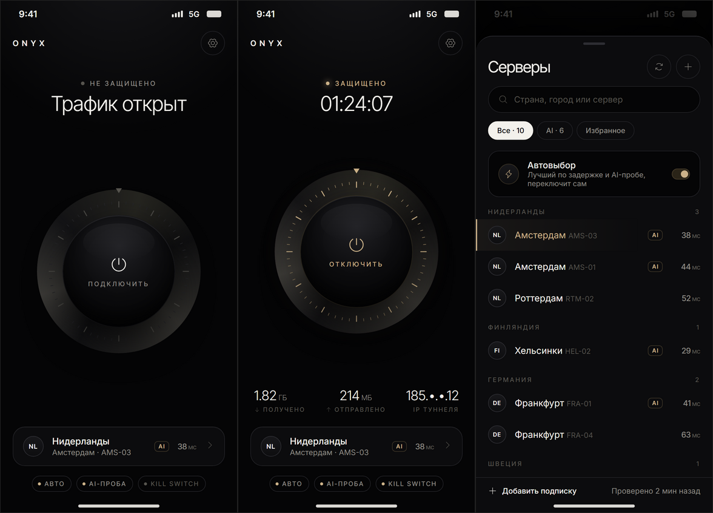
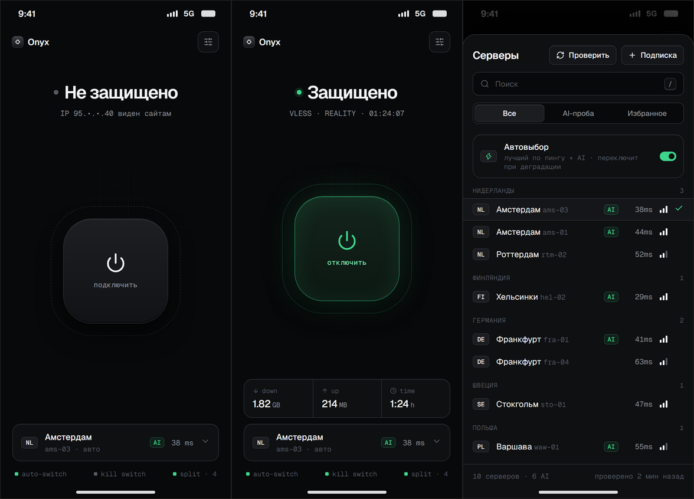
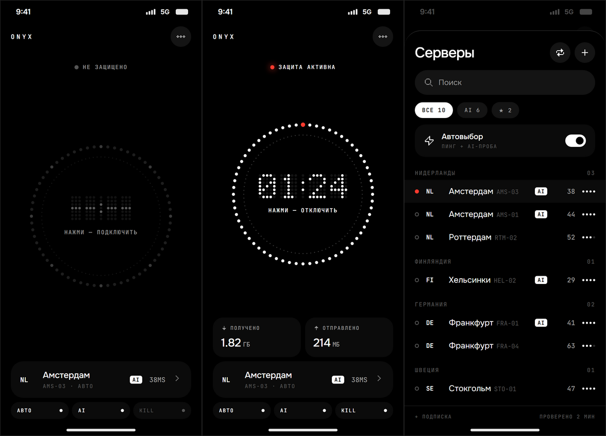
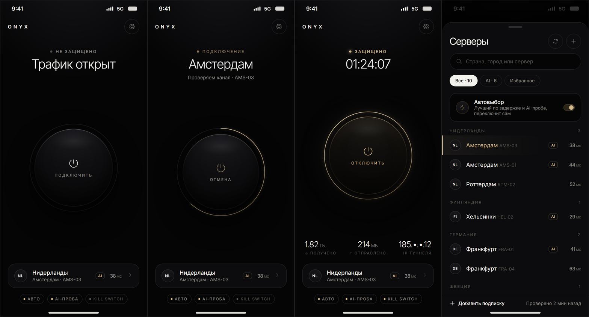
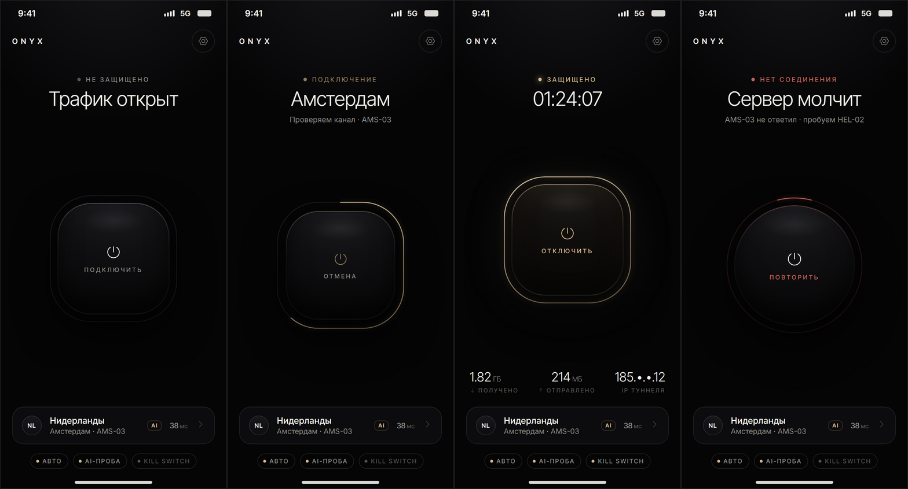

# Onyx VPN — редизайн, этап 1: концепции

Ветка `feat/redesign`. Код приложения на этом этапе не менялся.
Мокапы лежат в `docs/redesign/mockups/` в двойной плотности: телефон 390×844 → 780×1688, окно Windows 1100×720 → 2200×1440.
Исходники лежат в `docs/redesign/src/`: `mock.html` (одна страница на все направления, параметры в `#d=a|b|c&s=off|on|list&v=phone|desk`), `render.sh` (headless Edge из WSL), шрифты и иконки.

---

## 1. Почему сейчас похоже на нейрослоп

Разбор по `lib/core/theme/*`, `lib/core/glass_widget.dart`, `lib/core/cosmic_background.dart`, `home_screen.dart`, `node_list_sheet.dart`. Учтены незакоммиченные правки в основной папке: из кнопки убран BackdropFilter, у шторки уменьшен blur.

1. **Стандартный набор ИИ-шаблона.** Фиолетово-индиговый градиент `#9B8FFF→#5040CC`, неоново-мятный «aurora» `#00F5B4→#00C4D4`, космос с туманностью, звёздами и частицами, glassmorphism на каждой поверхности. Так выглядят тысячи сгенерированных лендингов, поэтому у приложения нет своего лица.
2. **Акцентов пять, а должен быть один.** Plasma, aurora, ember, nova, плюс голубой в градиенте. Каждое состояние кричит своим цветом и свечением, и глазу не на чем остановиться. Премиальный интерфейс держится на монохроме и одном сдержанном акценте.
3. **Свечения и glow вместо иерархии.** `boxShadow` с glow у кнопки, пульсация, орбитальное кольцо, зелёный радиальный «туман» при подключении. Эффекты подменяют композицию.
4. **Вечное движение.** Четыре `AnimationController` крутятся в `repeat()` всё время: фон 18 с, пульс, орбита, connected. Интерфейс не бывает спокойным, и это читается как дешёвое. Вдобавок это нагрузка: пользователь уже сам вычищал BackdropFilter, потому что на Adreno 642L лагала даже системная шторка.
5. **Заявленные шрифты на самом деле не подключены.** В теме прописаны `Syne`, `DM Sans`, `DM Mono`, но в `pubspec.yaml` нет секции `fonts:`, и `google_fonts` нигде не вызывается. На устройстве всё рендерится системным Roboto или Segoe UI с чужими letterSpacing и весами. Типографика задумана, но не работает.
6. **Glass без смысла.** `GlassCard` и `GlassPill` с blur 12–24 лежат поверх почти однотонного тёмного фона, размывать там нечего. Получается дорогая для GPU серая плашка.
7. **Тексты в духе «UI-шаблона».** КАПС «ПОДКЛЮЧИТЬ» внутри цветного шара, «Трафик зашифрован», бейдж «LIVE» с галочкой. Плюс emoji-флаги, которые на Windows рендерятся буквами (в коде даже есть костыль с «Segoe UI Emoji»).
8. **Перегруженный главный экран.** Вверху 4 иконки (лог, подписки, FAQ, настройки) плюс баннеры. Служебное (лог, FAQ) лежит на уровне главного действия.

---

## 2. Общие принципы для всех трёх направлений

- **Одна кнопка.** На главном экране только статус, герой-кнопка, текущий сервер и строка тихих индикаторов. Всё остальное открывается шторкой или настройками.
- **Монохром и один акцент.** Акцент означает только «защищено». «Не защищено» показано нейтральным серым, без красной тревоги.
- **Покой по умолчанию.** Анимация играет только на переходе состояния, в покое 0 кадров/с. Постоянный `repeat()` допустим только во время «Подключение…».
- **Без BackdropFilter в горячих местах.** Материалы делаются статичными градиентами, хайрлайнами и тенями. Blur допустим разве что на шторке, и то статичный.
- **Шрифты встроены в ассеты** (OFL), без сетевой загрузки, обязательно с кириллицей.
- **Флаги заменены кодами стран** (`NL`, `DE`): ровно на любой ОС и строже по стилю.
- **Числа моноширинные** (`tnum`): таймер и пинг не дёргаются.

### Где спрятаны функции

| Функция | Где живёт | Как видна на главном |
|---|---|---|
| AI-проба серверов | Шторка «Серверы»: бейдж `AI` у ноды, фильтр «AI», кнопка «Проверить» | Бейдж `AI` у текущего сервера, индикатор «AI-проба» |
| Автопереключение | Первая строка в шторке: «Автовыбор» с тумблером; в настройках раздел «Защита» | Индикатор «Авто»; при переключении тихий тост «Переключено на HEL-02 — задержка выросла» |
| Split-tunneling | Настройки → Защита → «Раздельный туннель» (Windows: правая панель) | Только в индикаторе (B: `split · 4`) |
| Kill switch | Настройки → Защита (Android: ссылка на системный Always-on VPN) | Индикатор «Kill switch» горит, когда активен |
| Импорт подписок | Шторка «Серверы»: «+ / Подписка», пустое состояние, вставка ссылки из буфера (распознаём автоматически) | Только при пустом списке: одна кнопка «Вставить подписку» |
| Лог, FAQ, обновления | Настройки → «О приложении / Диагностика» | Не видны; обновление показывается тихой точкой на иконке настроек |

На Windows дополнительно: палитра команд `Ctrl+K` («подключить», «сервер…», «kill switch», «импорт подписки»), `/` для поиска по серверам, `S` для выбора сервера. Палитра есть только в направлении B, но технически подходит к любому.

---

## 3. Направление A — «Обсидиан» (часовая механика, Apple Pro)

> Камень, сапфировое стекло и тонкий металл. Главная кнопка сделана как безель дорогих часов.

Мокапы: `a-phone-off.png`, `a-phone-on.png`, `a-phone-list.png`, `a-desktop-off.png`, `a-desktop-on.png`, `a-desktop-list.png`.

**Палитра** (тёплый чёрный, чуть в сторону камня):

| Токен | Hex | Роль |
|---|---|---|
| bg | `#050506` | фон |
| s1 | `#0C0C0E` | карточки, шторка |
| s2 | `#131316` | приподнятое |
| s3 | `#1B1B1F` | треки, поля |
| line | `#222226` / `#2E2E33` | хайрлайны |
| t1 | `#F3F1EC` | основной текст (тёплый белый) |
| t2 / t3 | `#8F8C86` / `#57554F` | вторичный / третичный |
| **акцент** | **`#CDB38A`** шампань, тёмный `#8C7A5C` | только «защищено» |

**Шрифты.** Inter Tight для дисплея и цифр (light 300 для таймера, широкий трекинг для капса), Inter для текста. Обе под SIL OFL 1.1, кириллица полная. Во Flutter: ассеты `.ttf` в `pubspec`, `fontFeatures: [FontFeature.tabularFigures()]`.

**Сетка и формы.** Поля 20, шаг 4/8. Радиусы: карточки 20, шторка 28, чипы и кнопки капсулы. На Windows две колонки: дайл и панель 392 px с секциями «Сервер / Сессия / Защита».

**Материалы.** Безель сделан conic-градиентом «шлифованный металл» (статичный, без анимации). Диск — радиальный «камень» с бликом сапфира сверху. Внутренняя тень глубины, хайрлайн 1 px. Blur нет.

**Герой.** Дайл 270 px на телефоне, 300 px на ПК: 60 рисок, метка на 12 часов.
- Отключено: риски графитовые, диск матовый.
- Подключение: «хронограф», риски загораются шампанью по кругу, 1 оборот ≈ 1,2 с, `easeInOutCubic`; диск чуть утапливается (scale 0,98).
- Подключено: все риски горят, метка шампань, вокруг диска едва заметное тёплое кольцо. Таймер сверху — это сам хронограф.
- Отключение: риски гаснут против часовой за 400 мс.
- Ошибка: метка на 12 часов дважды мигает приглушённым красным `#C2584B`, текст объясняет причину.
- Хаптика на Android: лёгкий тик при нажатии, двойной при «подключено».

**Иконки.** Phosphor, вес Light (MIT), пакет `phosphor_flutter`. Тонкая линия под стать рискам.

**Характер.** Самое «дорогое» и эмоциональное направление, сильнее всего связано с именем «Оникс». Риск: если переборщить с металлом, уйдёт в скевоморфизм. Безель должен оставаться приглушённым.

---

## 4. Направление B — «Графит» (Linear, Arc, Apple Pro tools)

> Инструмент для профи: хайрлайны, моно-метаданные, клавиатура. Главная кнопка сделана как большая механическая клавиша.

Мокапы: `b-phone-off.png`, `b-phone-on.png`, `b-phone-list.png`, `b-desktop-off.png`, `b-desktop-on.png`, `b-desktop-list.png`.

**Палитра** (холодный графит):

| Токен | Hex | Роль |
|---|---|---|
| bg | `#08090A` | фон, едва заметная сетка 24 px под героем |
| s1 | `#0F1012` | карточки |
| s2 | `#151619` | выделенная строка |
| s3 | `#1C1D21` | контролы |
| line | `#1F2024` / `#2B2D32` | хайрлайны |
| t1 | `#F4F5F6` | текст |
| t2 / t3 | `#8B9099` / `#555A63` | вторичный / метаданные |
| **акцент** | **`#3DD68C`** «ион», тёмный `#123A27` | только «защищено» |

**Шрифты.** Geist для интерфейса и Geist Mono для метаданных, пинга и подписей (Vercel, SIL OFL 1.1, кириллица есть, проверено рендером).

**Сетка и формы.** Поля 16, шаг 4. Радиусы мелкие и инженерные: 14 у карточек, 10 у кнопок, 5 у бейджей. Хайрлайн 1 px и `inset 0 1px 0 rgba(255,255,255,.04)` сверху как «фаска». Сегмент-контрол вместо чипов.

**Материалы.** Матовый графит, без стекла. Объём только у клавиши: вертикальный градиент, фаска и тень.

**Герой.** Клавиша-сквиркл 176 px (на ПК 200) в пунктирной рамке.
- Отключено: графитовая клавиша, белая иконка питания, подпись моно.
- Подключение: по контуру клавиши бежит световой штрих (conic-градиент по рамке, 900 мс на круг), клавиша нажата (сдвиг 2 px, тень короче).
- Подключено: контур и иконка цвета «ион», внутреннее свечение 10 %, пунктирная рамка становится сплошной. Под статусом моно-строка `VLESS · REALITY · 01:24:07`.
- Ошибка: короткий shake клавиши по горизонтали (3 колебания, 300 мс), моно-строка с кодом ошибки.
- Пружины без overshoot: `Curves.easeOutQuart`, 180–240 мс.

**Иконки.** Lucide, stroke 1.5 (ISC), пакет `lucide_icons_flutter`.

**Характер.** Самое ясное и масштабируемое направление, проще всего в реализации, лучше всего ложится на Windows (палитра команд, горячие клавиши, плотный список). Риск: самое «рациональное», на телефоне меньше эмоций и меньше связи с камнем.

---

## 5. Направление C — «Сигнал» (Nothing OS, минимализм Mullvad)

> OLED-чёрный, точечная матрица и один красный огонёк «в эфире».

Мокапы: `c-phone-off.png`, `c-phone-on.png`, `c-phone-list.png`, `c-desktop-off.png`, `c-desktop-on.png`, `c-desktop-list.png`.

**Палитра** (абсолютный чёрный):

| Токен | Hex | Роль |
|---|---|---|
| bg | `#000000` | фон (OLED: пиксели выключены, экономит батарею) |
| s1 | `#0B0B0B` | плитки |
| s2 | `#141414` | контролы, поиск |
| line | `#1C1C1C` / `#2A2A2A` | разделители |
| t1 | `#FFFFFF` | текст и «горящие» точки |
| t2 / t3 | `#9B9B9B` / `#555555` | вторичный / погашенные точки |
| **акцент** | **`#FF3B2F`** «REC» | одна точка: «в эфире / защищено», выбранный сервер |

**Шрифты.** Onest для интерфейса (OFL, кириллица от авторов из России), JetBrains Mono для капс-подписей (OFL). Табло сделано точечной матрицей 5×7, которую мы рисуем сами в `CustomPainter`: только цифры и `: -`, без шрифтовых лицензий.

**Сетка и формы.** Поля 20, крупные мягкие плитки с радиусом 20–24, без обводок: только разница `#000` и `#0B0B0B`. Капсулы и тумблеры iOS-подобные, но монохромные.

**Материалы.** Нет ничего: ни стекла, ни теней, ни градиентов. Всё держится на точках и пустоте.

**Герой.** Кольцо из 64 точек и внутренняя пунктирная «трасса», в центре табло.
- Отключено: точки погашены, на табло `--:--`.
- Подключение: точки загораются по часовой одна за другой (64 шага ≈ 1 с), как индикатор Glyph.
- Подключено: все точки белые, точка на 12 часов красная и раз в 2 с медленно «дышит». Табло показывает время сессии.
- Ошибка: кольцо дважды мигает, табло показывает `--:--`.
- Список: пинг — это 4 точки вместо полосок, выбранный сервер отмечен красной точкой.

**Иконки.** Pixelarticons (MIT), пиксельная сетка 24 px, рифмуется с точечной матрицей. Во Flutter подключаются как SVG через `flutter_svg` или собираются в icon-font.

**Характер.** Самое узнаваемое и смелое направление, лучшее для OLED и батареи. Риски: красный у VPN многие читают как «ошибка» (нужно отыграть подписью «Защита активна»), а эстетика Nothing узнаваема, поэтому важно не копировать её фирменный шрифт Ndot, что мы и не делаем.

---

## 6. Сравнение

| | A Обсидиан | B Графит | C Сигнал |
|---|---|---|---|
| Ощущение | роскошь, часы, камень | профессиональный инструмент | техно-минимализм |
| Связь с «Оникс» | ★★★ | ★★ | ★★ |
| Windows | ★★ | ★★★ | ★★ |
| Android / OLED | ★★★ | ★★ | ★★★ |
| Сложность реализации | средняя (дайл на CustomPainter, conic-металл) | низкая | средняя (dot-matrix painter) |
| Нагрузка на GPU | низкая | низкая | минимальная |
| Риск устаревания | низкий | низкий | средний (трендовая эстетика) |

## 7. Рекомендация

**A «Обсидиан» как основа, с инженерной дисциплиной из B.**

Название «Оникс» и запрос «мегакрасивый премиальный чёрный» лучше всего закрывает A: камень, металл и стекло прочитываются сразу, а у главной кнопки появляется своё лицо. Это не «ещё один зелёный круг». Из B стоит взять:
- хайрлайны и моно-метаданные в списке серверов и в правой панели Windows;
- палитру команд `Ctrl+K` и горячие клавиши на Windows;
- сдержанные пружины без overshoot.

Если пользователь хочет максимально современный и «технический» вид, лучше чистый B. C стоит брать, только если нравится именно эстетика Nothing.

## 8. Что дальше (этап 2, после выбора)

1. Токены: `OnyxColors`, `OnyxType`, `OnyxRadii`, `OnyxMotion` вместо `AppColors` и `AppTheme`. Шрифты в `assets/fonts` и `pubspec`.
2. Удалить `CosmicBackground`, `GlassCard` и `GlassPill` с blur; заменить на `Surface` и `Hairline`.
3. Герой-виджет: `CustomPainter` и один `AnimationController`, который работает только во время перехода состояния.
4. Главный экран, шторка серверов, настройки «Защита». Лог и FAQ переезжают в настройки.
5. Windows: двухколоночная раскладка, кастомный тайтлбар (в проекте уже есть `window_manager`), горячие клавиши.
6. Иконки приложения (Android adaptive и Windows `.ico`) в выбранном стиле.

Лицензии: Inter, Inter Tight, Geist, Geist Mono, Onest, JetBrains Mono — SIL OFL 1.1; Phosphor и Pixelarticons — MIT; Lucide — ISC. Все допускают встраивание в коммерческое приложение.

---

## 9. Итерация A2 — «Обсидиан» без часов (задача #32)

Пользователю понравился характер A, но метафора часов не нужна: нужен просто современный премиальный VPN. Что поменялось:

- **Убрано:** безель с 60 рисками, метка «12 часов», conic-«металл». От циферблата не осталось ничего.
- **Новая главная кнопка «Линза» (A2-1, основной вариант).** Чистый круг из чёрного камня с мягким объёмом (радиальный градиент, внутренняя тень) и световым ободком в 1 px: ярче сверху, гаснет к бокам. Вокруг на зазоре 13 px идёт тонкое кольцо 1,6 px, и в нём живёт состояние.
- **Альтернатива «Галька» (A2-2).** Тот же материал в форме скруглённого квадрата (squircle, радиус 30 %), прогресс бежит по контуру. Чуть «технологичнее», ближе к B.
- **Акцент** стал чуть светлее и современнее: `#D2B98F`, тёмный `#8E7B5B`. Ошибка показана приглушённым терракотовым `#C8655A`, не кислотным красным.
- **Из B взято:** хайрлайны, `Ctrl K` и `S` на Windows, тихий тост автопереключения внизу, пружины без overshoot.

### Состояния кнопки и анимации

| Состояние | Кнопка | Кольцо | Заголовок |
|---|---|---|---|
| Отключено | матовый камень, белый ободок сверху | графитовый трек | «Не защищено · Трафик открыт» |
| Подключение | утоплена до 0,975, ободок тёплый | шампань-дуга растёт от 12 ч по часовой, длина = реальный прогресс этапов (проверка → рукопожатие → туннель); пока этап ждёт, дуга медленно «дышит» по яркости 0,6↔1, период 1,6 с | «Подключение · Амстердам», под ним этап |
| Подключено | ободок шампань, мягкое тёплое свечение 90 px | кольцо замкнуто, свечение 6 px | «Защищено · 01:24:07» |
| Ошибка | подпись «Повторить» терракотовым | короткий терракотовый сегмент сверху, 2 мягких вспышки и покой | «Нет соединения · Сервер молчит», что делаем дальше |
| Отключение | — | кольцо стягивается против часовой за 350 мс | — |

Тайминги: переходы 240–350 мс, `Curves.easeOutCubic`, без overshoot. В покое (отключено или подключено) анимации стоят, 0 кадров/с. Кольцо рисуется в `CustomPainter`, blur нет; свечение делается тенью и рисуется один раз.

### Мокапы A2

- Телефон, основной вариант «Линза»: `a2-phone-off.png`, `a2-phone-ing.png`, `a2-phone-on.png`, `a2-phone-err.png`, `a2-phone-list.png`.
- Телефон, вариант «Галька»: `a2v2-phone-off.png`, `a2v2-phone-ing.png`, `a2v2-phone-on.png`.
- Windows: `a2-desktop-off.png`, `a2-desktop-on.png`.
- Обзоры: `overview-a2-phone.png` (отключено, подключение, подключено, список), `overview-a2-variant2-and-error.png` («Галька» и экран ошибки).

**Рекомендация:** «Линза» (A2-1). Круг читается как кнопка мгновенно на обеих платформах, кольцо прогресса естественно ложится на круг, и форма не спорит с карточкой сервера и чипами (у них скругления, не углы).

---

## 10. Три темы приложения (задача #33)

Решение пользователя: в приложении три темы, переключаются в настройках.

| Тема | Основа | По умолчанию |
|---|---|---|
| **Onyx** | A2, кнопка «Линза» | да |
| **Signal** | C, доведённый до уровня A2 | |
| **Material 3 Expressive** | M3 Expressive из приложения МИТСО (токены, MotionScheme, шкала форм, dynamic color) | |

### Мокапы

- Signal: `c2-phone-{off,ing,on,err,list}.png`, `c2-desktop-{off,on}.png`, `overview-c2-phone.png`.
- M3 Expressive: `m3-phone-{off,ing,on,err,list}.png`, `m3-desktop-{off,on}.png`, `overview-m3-phone.png`.
- Листы фирменных деталей: `details-a2.png`, `details-c2.png`, `details-m3.png`.
- Onyx с флагами: `a2-phone-list-flags.png`, `a2-phone-on-flags.png`.

### Флаги (без emoji)

| Тема | Как | Источник |
|---|---|---|
| Onyx | круглый флаг, насыщенность −12 %, хайрлайн `rgba(255,255,255,.14)`, блик сверху и тень снизу | **circle-flags** (HatScripts, MIT) |
| Signal | точечная матрица 7×5…10×7: флаг растеризуется в маленькую сетку, яркость квантуется в 4 уровня белого, монохром | **flag-icons** (lipis, MIT), 1×1 |
| M3 Expressive | флаг в форме MaterialShapes; форма закреплена за страной (NL → Cookie4, FI → Clover4…) и морфится в Circle при нажатии | **flag-icons** (lipis, MIT), 1×1 |

Код страны берём из имени ноды (emoji регионального индикатора → ISO-код, иначе словарь названий), на стороне UI, без правок domain.

### Фирменные детали

**Onyx**
1. «Линза» с кольцом прогресса и тёплым свечением (раздел 9).
2. Круглые флаги с хайрлайном и тонкие трёхполосные индикаторы пинга шампанью.
3. Тихий тост автопереключения `AMS-01 → HEL-02 · 112 → 29 мс`; хаптика: light / двойной мягкий / heavy.
4. Иконка: чёрный сквиркл с маленькой линзой и шампань-ободком. Сплэш: ободок «зажигается» сверху вниз.

**Signal**
1. Кольцо из 64 точек. Подключение: точки загораются по часовой с «хвостом», в центре dot-matrix процент. Подключено: красная REC-точка и таймер. Ошибка: три красные точки сверху и `ERR`.
2. Флаги и пинг из точек (4 точки = отличный пинг); выбранный сервер помечен красной точкой.
3. Хаптика как «щелчки механизма»: тик каждые 8 точек при подключении, confirm / reject.
4. Иконка: чёрный квадрат с кольцом точек и красной точкой; сплэш — кольцо загорается за 600 мс.

**Material 3 Expressive**
1. Главная кнопка — «печенька» MaterialShapes: Cookie9 (primaryContainer) → при подключении морф и вращение как `ContainedLoadingIndicator` → Sunny (primary) подключено → Puffy (errorContainer) ошибка. Морф на пружинах `ExpressiveMotion` (spatial), цвет на effects.
2. Wavy linear progress под заголовком во время подключения, сегментированный список серверов (радиусы 20/4) и флаги в формах.
3. Снэкбар с действием «Отменить» при автопереключении; dynamic color на Android 12+, тематическая монохромная иконка.

### Реализация (план)

- `OnyxThemeKind { onyx, signal, material }` хранится в `SharedPreferences`, переключается в «Настройки → Оформление».
- Общие токены лежат в `ThemeExtension<OnyxTokens>` (цвета ролей, радиусы, шрифты, моторика). Каждая тема даёт свой набор `ThemeData` и свою реализацию главной кнопки, флага и индикатора пинга через `OnyxThemeKit` (фабрика виджетов).
- Шрифты встроены в `assets/fonts`: Inter, Inter Tight (Onyx); Onest, JetBrains Mono (Signal); Roboto Flex (M3 на Windows, на Android системный Roboto).

---

## 11. Material 3 Expressive — каноничная версия (итерация 2)

Замечание пользователя: «фигуры не как из оригинальной Material 3, нужно смотреть гайдлайны». Что изменилось:

- **Фигуры — эталонные, а не нарисованные на глаз.** Контуры выгружены из `material_new_shapes`: это Dart-порт `androidx.graphics.shapes`, параметры `MaterialShapes` (вершины, rounding, innerRadius) повторяют Compose Material3. Скрипт `docs/redesign/src/tool/m3_shapes_dump_test.dart` выгружает данные в `docs/redesign/src/m3-shapes.js`. Морф — `Morph` из той же библиотеки. Последовательность форм LoadingIndicator — `IndeterminateIndicatorPolygons`: SoftBurst → Cookie9Sided → Pentagon → Pill → Sunny → Cookie4Sided → Oval.
- **Компоненты — по страницам m3.material.io/components с токенами**: Top app bar small, Lists segmented, Filter chips, Search bar, Switch, Linear wavy progress, Loading indicator contained, Bottom sheet, Snackbar, Filled/Tonal buttons, Standard icon buttons, Filled card (`medium` 12). Источники — выгрузка `.m3-guidelines` и справочник `mitso_schedule/docs/m3`.
- **Navigation bar и rail осознанно не используются**: у приложения одно назначение, а гайдлайн требует от 3 до 5 пунктов.
- Флаги по-прежнему обрезаются фигурами, но теперь официальными MaterialShapes (роль «avatars / image crops»).
- Цвета: baseline dark (Flutter `_colorSchemeDarkM3` / Compose `ColorDarkTokens`); на Android 12+ — dynamic color.

Мокапы: `m3c-phone-{off,ing,on,err,list}.png`, `m3c-desktop-{off,on}.png`, `overview-m3c-phone.png`, `details-m3c.png`.
Лист-сверка: `m3c-checklist.png` («экран → компонент → страница гайдлайна → ключевые токены»).
Старые `m3-*` и `details-m3.png` больше не актуальны, оставлены для истории.
